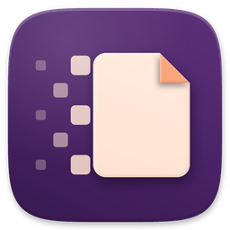
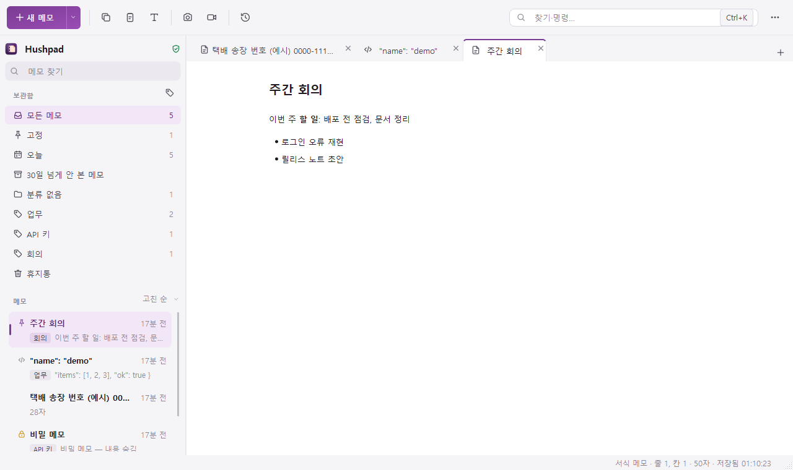
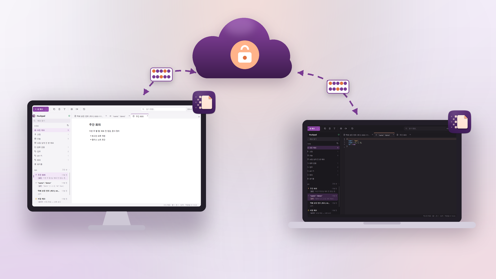

  

<h1 align="center">Hushpad</h1>

  <b>조용히 적고, 아무도 못 보게</b> 
  Write quietly. Seen by no one.

  
  
  
  
  

  

  <a href="https://github.com/wind2sp/hushpad/releases/latest/download/Hushpad-win64-setup.exe"><b>⬇ Windows 설치 프로그램</b></a>
  &nbsp;·&nbsp;
  <a href="https://github.com/wind2sp/hushpad/releases/latest/download/Hushpad-win64.zip">Windows 포터블 zip</a>
  &nbsp;·&nbsp;
  <a href="https://github.com/wind2sp/hushpad/releases/latest/download/Hushpad-macos-arm64.zip"><b>⬇ macOS용 받기 (Apple Silicon)</b></a>
  &nbsp;·&nbsp;
  <a href="https://gdra.mycafe24.com/hushpad/">홈페이지</a>
  &nbsp;·&nbsp;
  <a href="#english-short">English</a>

  <picture>
    <source media="(prefers-color-scheme: dark)" srcset="website/assets/img/app-dark.png">
    
  </picture>

**Hushpad(허시패드)** = hush(쉿, 조용히) + pad(메모장). 메모장 탭에 적어 두던 임시 기록, 붙여넣기 전 보관, 암호·API 키, HTML·JSON, 스크린샷·짧은 녹화를 한곳에 조용히 담아 둡니다. 무료 오픈소스(GPL-3.0-or-later)입니다.

- **저장 버튼이 없어요.** 쓰는 즉시 저장되고, 재부팅해도 메모와 열어 둔 탭이 그대로예요.
- **모든 메모를 암호화해요.** AES-256-GCM으로 암호화된 파일만 보관 폴더에 남아서, 다른 프로그램이나 클라우드가 내용을 읽지 못해요.
- **Windows에서는 캡처·화면 공유에 창이 안 보여요.** macOS 15 이상에서는 일부 캡처·화면 공유 앱에 보일 수 있어요.
- **서식 그대로 또는 글자만** 복사하고 붙여요. HTML·JSON용 코드 메모, 스크린샷·짧은 화면 녹화도 메모에 바로 들어가요.
- **어디서든 단축키로:** Ctrl+Alt+N 새 메모, Ctrl+Alt+M 클립보드를 메모로, Ctrl+Alt+S 스크린샷.
- **화면 언어:** 한국어 · English · 日本語 · 简体中文.

## 여러 PC에서 꺼내 쓰는 나만의 보안 지갑

보관 폴더를 **OneDrive·Dropbox·Google Drive나 회사 공유 폴더(NAS)** 안에 두면, 집과 회사의 여러 PC가 같은 메모를 함께 씁니다. 서버 비밀번호, API 키, 계정 정보처럼 늘 들고 다녀야 하는 비밀을 어느 PC에서든 꺼내 쓰는 **나만의 보안 지갑**이 됩니다.

- **바로 반영돼요.** Hushpad는 보관 폴더를 3초마다 확인해서, 다른 PC에서 쓴 메모가 동기화되는 대로 목록과 열린 탭에 나타납니다(도착 속도는 클라우드 동기화 속도를 따릅니다).
- **클라우드에는 암호화된 파일만 올라가요.** 메모마다 AES-256-GCM으로 암호화된 파일이라 클라우드 회사도 내용을 읽을 수 없습니다.
- **따로 가입할 서버가 없어요.** 이미 쓰는 클라우드 폴더를 그대로 씁니다. 새 PC에서는 같은 폴더를 고르고 암호를 한 번만 넣으면 됩니다(Windows·Mac 함께).
- **동시에 고쳐도 사라지지 않아요.** 두 PC에서 같은 메모를 동시에 고치면 한쪽을 "충돌 사본"으로 남깁니다.
- 지금 쓰는 메모를 옮기려면 `⋯ › 파일 › 보관 폴더 바꾸기/옮기기...`에서 클라우드 폴더를 고르세요.
- 클라우드 파일이 새더라도 안전하려면 **여러 단어로 된 긴 암호**를 쓰세요. 아주 중요한 PC에서는 `⋯ › 보안 › 이 PC에서 암호 잊기`로 켤 때마다 암호를 묻게 할 수 있습니다.

## 받기
| | 받는 곳 | 지원 |
|---|---|---|
| **Windows (권장)** | [Microsoft Store](https://apps.microsoft.com/detail/9P73RW8W1FQV) — 경고 창 없이 설치, 업데이트 자동 | Windows 10(2004 이상)·11, 64비트 |
| Windows (설치 프로그램) | [Hushpad-win64-setup.exe](https://github.com/wind2sp/hushpad/releases/latest/download/Hushpad-win64-setup.exe) — 내 계정 폴더에 설치(관리자 권한 없음), 시작 메뉴 등록, 설정 › 앱에서 제거 | Windows 10(2004 이상)·11, 64비트 |
| Windows (포터블 zip) | [Hushpad-win64.zip](https://github.com/wind2sp/hushpad/releases/latest/download/Hushpad-win64.zip) — 설치 없이 풀어서 실행 | Windows 10(2004 이상)·11, 64비트 |
| macOS | [Hushpad-macos-arm64.zip](https://github.com/wind2sp/hushpad/releases/latest/download/Hushpad-macos-arm64.zip) | Apple Silicon(M1 이후). **Intel Mac용은 없습니다** |

- **설치 프로그램**은 `%LOCALAPPDATA%\Programs\Hushpad`에 설치합니다. 제거해도 메모(보관 폴더)와 설정은 남습니다.
- **zip은** 설치 과정이 없는 포터블 앱입니다. zip을 풀고 `Hushpad.exe`(macOS는 `Hushpad.app`)를 실행하면 처음에 보관 폴더와 암호(8자 이상)를 정합니다.
- 설치 프로그램과 zip은 서명하지 않은 앱이라 Windows는 "PC 보호" 창에서 **추가 정보 › 실행**, macOS는 처음 한 번 **오른쪽 클릭 › 열기**가 필요합니다.
- **자동 업데이트**(설치판 1.0.3부터, zip판 1.0.2부터): 켤 때와 하루 한 번 GitHub 릴리스에서 새 버전을 확인하고, 바뀐 점을 보여 준 뒤 "지금 업데이트"를 고르면 받은 파일의 SHA-256을 확인하고 설치판은 새 설치 프로그램을 조용히 실행, zip판은 같은 폴더에 바꿔 넣은 뒤 다시 켭니다(zip판은 새 exe의 자체 점검까지 확인). 메모·설정은 보내지 않으며, `⋯ › 보안 › 업데이트 자동 확인`으로 끌 수 있습니다. 1.0.1 이하를 쓰고 있다면 이번 한 번만 새 zip을 받아 원래 폴더에 덮어써 주세요.
- 처음 실행하면 "Windows 시작할 때 실행"(macOS: 로그인할 때 실행)이 켜집니다. 트레이(메뉴 막대) 아이콘 오른쪽 클릭으로 끌 수 있어요.
- Windows 10 2004(빌드 19041) 이전 버전과 macOS 15 이상에서는 Hushpad의 스크린샷·녹화가 찍는 동안 Hushpad 창을 잠깐 숨겼다가 다시 보입니다. 이런 OS에서는 창을 캡처에서 빼는 기능이 제대로 듣지 않기 때문입니다(오래된 Windows 10은 다른 캡처 프로그램에서 창이 검게 찍힙니다).
- 받은 파일이 맞는지는 릴리스 페이지의 SHA-256 값과 비교해 확인하세요 (Windows: `Get-FileHash 파일.zip`, macOS: `shasum -a 256 파일.zip`).

### Microsoft Store 버전
[Microsoft Store](https://apps.microsoft.com/detail/9P73RW8W1FQV)에서 받는 버전은 zip과 같은 프로그램을 MSIX 패키지로 묶은 것입니다(`packaging\msix\`). Microsoft가 서명해 배포하므로 "PC 보호" 경고가 뜨지 않고, 새 버전은 Store가 자동으로 설치합니다. 다른 점은 이것뿐입니다.
- 시작할 때 실행은 레지스트리 대신 패키지의 시작 작업으로 합니다. 설치 뒤 처음부터 켜져 있고, 끄고 켜기는 `⋯ › 보안` 또는 트레이 메뉴의 **Windows 시작 프로그램 설정 열기…**(Windows `설정 › 앱 › 시작 프로그램`)에서 합니다.
- 설정·백업·이 PC에 기억한 암호는 Windows가 패키지 전용 폴더로 옮겨 보관합니다. 그래서 **Store 앱을 제거하면 설정·하루 백업·기억한 암호가 함께 지워집니다.** 보관 폴더(기본 `문서\Hushpad`)의 메모는 지워지지 않으며, 다시 설치하면 같은 폴더를 고르고 암호를 넣으면 됩니다.
- zip 버전과 함께 쓰면 두 쪽의 설정은 따로 저장됩니다. 같은 보관 폴더를 고르면 메모는 함께 씁니다.

## 언어
- 한국어 · English · 日本語 · 简体中文. `⋯ › 보기 › 언어`에서 바꾸고, **지금 다시 시작**을 누르면 열린 메모를 모두 저장한 뒤 다시 켜집니다.
- 기본은 **시스템 따라가기**: 운영체제 언어가 위 넷 중 하나면 그 언어, 아니면 영어(번체 중국어도 아직은 영어). 설정 파일의 `"language"`에 저장됩니다.
- 날짜·"5분 전" 같은 시각도 언어에 맞춰 보입니다. 단축키는 언어와 상관없이 같습니다.
- 일본어·중국어에서는 그 언어에 맞는 글꼴(Yu Gothic UI·Meiryo / Microsoft YaHei, macOS는 Hiragino Sans / PingFang SC)을 먼저 씁니다.
- 한국어·일본어·중국어에서는 Qt 기본 단추(OK·Cancel 등)도 그 언어로 바뀝니다.

## 저장
- 저장 버튼이 없습니다. 쓰는 즉시(0.6초 뒤) 자동 저장되고, 저장할 때 임시 파일에 쓴 뒤 바꿔치기해서 저장 도중 꺼져도 이전 내용이 남습니다.
- 모든 메모는 **보관 폴더 한 곳**에 메모 1개 = 파일 1개(`notes\20261115-143205-xxxx.own`)로, 만든 시각을 이름으로 저장됩니다.
- 10분마다 이전 버전이 쌓입니다(메모마다 최근 40개) → `메모 › 이전 버전 보기` (Ctrl+Shift+H).
- 하루 한 번 이 PC의 `%LOCALAPPDATA%\Hushpad\backups`(macOS: `~/Library/Application Support/Hushpad/backups`)에 메모(`notes\`)·금고 파일·분류를 zip으로 백업합니다(14일치, 암호화된 상태 그대로). 동영상(`media\`)과 이전 버전(`history\`)은 크기 때문에 백업에 넣지 않습니다.

## 암호화·다른 프로그램과 안 섞이게
- 파일 내용은 AES-256으로 암호화됩니다. 다른 프로그램·검색 색인·클라우드가 파일을 읽어도 내용을 알 수 없습니다.
- 이 PC에서는 암호를 처음 한 번만 넣습니다(Windows는 DPAPI로 Windows 계정에 묶어, macOS는 로그인 키체인에 기억). 다른 계정이나 다른 PC에서는 풀 수 없습니다.
- **여러 PC에서 같이 쓰기**: 보관 폴더를 Dropbox·OneDrive 안에 두고, 다른 PC에서도 같은 폴더를 고른 다음 같은 암호를 넣으면 됩니다. 다른 PC에서 고친 내용은 3초 안에 반영되고, 양쪽에서 동시에 고치면 이 PC 쪽 내용이 "(충돌 사본)"으로 따로 저장됩니다.
- 복사한 내용은 Windows 클립보드 기록(Win+V)·클라우드 클립보드에 남지 않습니다(`보안` 메뉴에서 끌 수 있음).
- **비밀 메모**(🔒): 목록에 첫 줄이 보이지 않고, 복사하면 클립보드 관리 프로그램도 못 보며 30초 뒤 클립보드를 비웁니다.
- Windows에서는 Hushpad 창이 다른 프로그램의 스크린샷·화면 녹화·화면 공유에 보이지 않습니다(`캡처` 메뉴에서 끌 수 있음). macOS는 아래 "macOS"의 한계를 보세요.
- ⚠ 암호를 잊으면 아무도 되살릴 수 없습니다. `파일 › 내보내기`로 만든 파일은 암호화되지 않은 일반 파일입니다.

## 두 종류의 메모
| | 서식 메모 (Ctrl+N) | 텍스트 메모 (Ctrl+Shift+N) |
|---|---|---|
| 용도 | 웹·워드에서 복사한 내용, 이미지, 스크린샷, 동영상 | HTML·JSON·코드·API 키 |
| 붙여넣기 | 서식 그대로 (Ctrl+Shift+V는 텍스트만) | 언제나 텍스트만 |
| 기타 | `보기 › 텍스트만 보기`(Ctrl+T) | 줄 번호, 색 구분, 자동 들여쓰기, JSON 정리(Ctrl+Alt+J) |

서식 메모도 '텍스트만' 버전을 늘 함께 가지고 있어서, 밖으로 보낼 때 고를 수 있습니다:
Ctrl+C 서식 포함 복사 · **Ctrl+Shift+C 텍스트만 복사** · Ctrl+Alt+C 메모 전체(서식) · Ctrl+Alt+Shift+C 메모 전체(텍스트).

## 탭과 목록
- 목록을 한 번 누르면 **미리보기 탭**(◌, 다른 메모를 누르면 그 자리에 바뀜)으로 열리고, 고치거나 두 번 누르면 고정 탭이 됩니다 → 탭이 쌓이지 않습니다.
- 탭을 닫아도 메모는 목록에 남습니다. 아무것도 안 쓴 새 메모만 닫을 때 사라집니다.
- 이름을 안 정하면 탭에 `첫 줄 · 11-15 14:32`(만든 때)로 보여 비슷한 제목이 구분됩니다. 이름은 F2 또는 탭 두 번 클릭.
- 분류: 메모를 왼쪽 분류로 끌어다 놓거나 Ctrl+M. 📌 고정(Ctrl+P), 🗑 휴지통(되살리기 가능).
- 합치기: 목록에서 Ctrl/Shift로 여러 개 고르고 Ctrl+Shift+M (만든 순서대로 이어 붙이고 원래 메모는 휴지통으로 옮길지 묻습니다).
- 찾기: Ctrl+E 목록 전체에서, Ctrl+F/Ctrl+H 지금 메모에서 찾기·바꾸기.
- `파일 › Windows 메모장 탭 가져오기`: 메모장에 열려 있는 탭(저장 안 한 것 포함)을 복사해 옵니다. 메모장 쪽은 건드리지 않습니다.
- 파일(txt·json·html·그림)을 목록에 끌어다 놓으면 메모로 가져옵니다.
- 원격 접속(크롬 원격 데스크톱·AnyDesk·팀뷰어 등)이나 화면 공유에서 Hushpad 창이 검게 보이면, 작업 표시줄 트레이 아이콘 우클릭 › **원격으로 볼 때 잠깐 보이기…** 에서 암호를 넣어 15분~2시간 동안 보이게 할 수 있습니다. 시간이 지나거나 잠그면 다시 숨겨집니다.
- 메모 속 그림을 눌러 웹 채팅·메일의 첨부 칸이나 탐색기로 끌어다 놓으면 PNG 파일로 바로 첨부됩니다(따로 저장할 필요 없음). 이때 만든 임시 파일은 30분 뒤나 Hushpad를 끝낼 때 지웁니다.

## 스크린샷·화면 녹화
- 📷 **Ctrl+Alt+S**(어디서든) / Ctrl+Shift+S: 영역을 끌어서 고르면(Enter = 화면 전체) 지금 서식 메모에 넣고 클립보드에도 복사합니다.
- 🎬 **Ctrl+Alt+R**(어디서든) / Ctrl+Shift+R: 영역을 고르면 녹화 시작(최대 3분). 빨간 테두리와 ⏸·⏹ 버튼 막대는 화면에 보이지만 녹화에는 찍히지 않습니다.
  다시 Ctrl+Alt+R 또는 ⏹ 저장으로 끝내면 미리보기 그림이 메모에 들어가고, 두 번 클릭하면 재생됩니다.
  동영상은 암호화되어 보관 폴더 `media\`에 저장되고, 재생할 때는 메모리에서 풀어 재생합니다. 녹화하는 동안만 이 PC의 임시 폴더(`%LOCALAPPDATA%\Hushpad\tmp`)에 암호화 전 파일이 잠깐 생기고, 끝나면 바로 지웁니다(비정상 종료로 남으면 다음 실행 때 지웁니다).
- Windows에서는 Hushpad 창이 캡처에 안 찍히므로 창을 치우지 않고 그대로 찍어도 됩니다.

## 어디서든 쓰는 단축키 (트레이에 있어도 동작)
| 단축키 | 하는 일 |
|---|---|
| Ctrl+Alt+N | 새 메모 (창을 앞으로) |
| Ctrl+Alt+M | **지금 클립보드를 메모로 저장** — 창을 띄우지 않고 조용히 (글·이미지·HTML) |
| Ctrl+Alt+S / Ctrl+Alt+R | 스크린샷 / 화면 녹화 |

창을 닫으면 트레이(작업 표시줄 오른쪽)에 남습니다. 완전히 끝내려면 Ctrl+Q 또는 트레이 메뉴 › 끝내기.
처음 실행할 때 "Windows 시작할 때 실행"이 켜집니다. 트레이 아이콘 오른쪽 클릭이나 `⋯ › 보안`에서 끄고 켤 수 있어요(창 닫으면 트레이에 남기도 같은 메뉴).

## 편하게 쓰는 기능
- **Ctrl+K 찾기·명령**: 메모 제목·내용과 모든 명령을 한 곳에서 찾아 Enter로 실행.
- **잠금 Ctrl+L**: 보관 폴더 암호로만 열림. `⋯ › 보안`에서 자리 비우면(5·10·30분) / Windows 잠글 때 자동 잠금.
- **비밀 메모 가림막**: 비밀 메모는 열 때마다 내용이 가려져 있고, 눌러야 보입니다(옆 사람·화면 공유 대비).
- **값만 복사**: 코드 메모에서 `API_KEY=sk-…`, `"token": "…"` 줄을 오른쪽 클릭 → "이 줄 값만 복사".
- **스마트 분류**: 오늘 고친 메모 / 30일 넘게 안 본 메모(정리용).
- **항상 위에 Ctrl+Alt+T**: 다른 프로그램에 옮겨 적을 때 창을 위에 고정.
- **테마**: `⋯ › 보기 › 테마` — 시스템 따라가기·밝게·어둡게.

## macOS
같은 코드가 macOS에서도 돌도록 OS마다 다른 부분을 `hushpad_app\plat\`(win.py · mac.py · base.py)에 모았습니다. Windows 동작은 그대로입니다.

| 기능 | Windows | macOS |
|---|---|---|
| 이 PC에 암호 기억 | DPAPI (`%LOCALAPPDATA%\Hushpad\keys.json`) | 로그인 키체인 (서비스 `Hushpad`, `/usr/bin/security`) |
| 캡처·화면 공유에서 창 숨기기 | SetWindowDisplayAffinity | NSWindow 공유 끔(sharingType = None) |
| 어디서든 쓰는 단축키 | Ctrl+Alt+S/R/N/M | ⌃⌥S/R/N/M (Control+Option, Carbon 단축키) |
| 시작할 때 실행 | 레지스트리 Run 키 | `~/Library/LaunchAgents/com.hushpad.app.plist` (다음 로그인부터) |
| 클립보드 기록에서 빼기 | Win+V 기록·클라우드 제외 형식 | `org.nspasteboard.TransientType`/`ConcealedType` 표시 |
| 설정·백업 폴더 | `%APPDATA%`·`%LOCALAPPDATA%\Hushpad` | `~/Library/Application Support/Hushpad` |
| 메모장 탭 가져오기, Windows 잠글 때 함께 잠그기, 제목 표시줄 색 | 있음 | 없음(메뉴에서 숨김). 제목 표시줄은 밝게/어둡게만 맞춤 |

- 앱 안 단축키는 같은 키를 쓰고, macOS에서는 Qt가 Ctrl을 ⌘로 바꿉니다(메뉴·툴팁·팔레트 표시도 ⌘ 기호로).
- **화면 기록 권한**: 스크린샷·녹화를 처음 하면 macOS가 권한을 묻습니다. 거절했거나 화면이 비어 찍히면
  `시스템 설정 › 개인정보 보호 및 보안 › 화면 및 시스템 오디오 기록`에서 Hushpad를 켜고 다시 시작하라고 안내합니다.
- ⚠ **캡처 숨기기의 한계**: macOS 15 이상에서 ScreenCaptureKit을 쓰는 일부 캡처·화면 공유 프로그램은 창의 공유 끔 설정을 무시하고 Hushpad 창을 찍을 수 있습니다. Windows만큼 믿지 마세요.
- 클립보드 표시는 PySide6에 `QUtiMimeConverter`가 있을 때만 붙습니다(없으면 그냥 복사). Maccy·Raycast·Alfred처럼 nspasteboard.org 약속을 따르는 클립보드 관리 프로그램만 이 표시를 존중합니다. 비밀 메모 30초 뒤 지우기는 그대로 동작합니다.
- **서명·공증 안 됨**: 받은 `Hushpad.app`을 처음 열 때 "확인되지 않은 개발자" 경고가 뜨면 Finder에서 오른쪽 클릭 › 열기(또는 `시스템 설정 › 개인정보 보호 및 보안`의 "그래도 열기"). Apple Developer ID(연 99달러)로 서명하고 공증(notarize)하면 이 경고 없이 열리고, 키체인·화면 기록 권한도 앱 업데이트 뒤에 다시 묻지 않습니다.
- macOS 빌드는 GitHub의 Mac(Apple Silicon)에서 만들고 자체 점검(키체인 포함)을 통과합니다. 캡처 숨기기·단축키·화면 기록 권한처럼 화면이 필요한 기능은 실제 Mac에서 아직 충분히 확인하지 못했습니다. 문제가 있으면 이슈로 알려 주세요.

## 개발
- 실행: `python hushpad_main.py` · 점검: `python hushpad_main.py --selftest` (결과 `%TEMP%\hushpad_selftest.txt` — 번역 문구 목록 네 개가 서로 맞는지도 검사)
- 다른 OS 흉내: `python tests/sim_platform.py darwin` / `linux`
- 빌드: `python build.py` → Windows `dist\Hushpad\Hushpad.exe`, macOS `dist/Hushpad.app` (빌드 후 자체 점검까지)
- macOS 빌드는 GitHub Actions `build-macos`를 손으로 실행(Run workflow)합니다(push에는 돌지 않음). `macos-latest`(Apple Silicon)에서 `Hushpad-macos-arm64.zip`을 만들어 초안 릴리스 `mac-build`에 올립니다. Intel Mac 빌드는 만들지 않습니다.
- 필요: Python 3.14와 `requirements.txt`의 고정 버전(PySide6 6.12, cryptography 48, Pillow, PyInstaller) — macOS 기능은 ctypes로 시스템 라이브러리를 직접 부름
- 빌드는 쓰지 않는 Qt 가상 키보드·QML·소프트웨어 OpenGL을 빼고, `LICENSE`·`NOTICE`·`THIRD_PARTY_NOTICES.md`·`licenses\`를 함께 넣습니다.
- 구성: `hushpad_app\` — crypto(암호), store(저장), editors(편집기), capture(캡처·녹화), window(주 창), notepad_import, i18n(번역), plat(OS별 기능)
- 번역: 화면 문구는 모두 `tr("열쇠")`로 `hushpad_app\locales\{ko,en,ja,zh}.json`에서 가져옵니다. 문구를 더하면 네 파일에 같은 열쇠를 넣으세요(`열쇠@mac`은 macOS에서만 쓰는 문구). 언어별 화면: `docs\i18n\`

## 문의

- 사용·제휴·버그 문의는 **wind2sp@9rowpar.com**으로 보내 주세요. 버그는 [GitHub Issues](https://github.com/wind2sp/hushpad/issues)에 올려도 됩니다. 보안 문제는 [SECURITY.md](SECURITY.md)를 따라 주세요.

## 라이선스

- **무료 오픈소스, [GPL-3.0-or-later](LICENSE)** (GNU 일반 공중 사용 허가서 3판 또는 그 이후 판). 소프트웨어는 "있는 그대로" 제공되며 어떠한 보증도 하지 않습니다. 수정본을 배포할 때는 같은 라이선스로 소스 코드를 함께 공개해야 합니다.
- © 2026 NINEROW partners Co., Ltd. (나인로우파트너스(주)) and Hushpad contributors — 자세한 내용은 [NOTICE](NOTICE).
- Hushpad 이름과 아이콘은 상표입니다. GPL 3판 7조 (e)에 따라 라이선스는 이름·아이콘 사용 권한을 주지 않습니다. 수정본은 다른 이름과 아이콘을 써 주세요.
- 함께 배포하는 오픈소스(Qt for Python·Qt — LGPL-3.0, cryptography, OpenSSL 등)와 출처는 [THIRD_PARTY_NOTICES.md](THIRD_PARTY_NOTICES.md)에 있습니다.

## English (short)

Hushpad is a quiet, private notepad for Windows and macOS (Apple Silicon). Notes save as you type, every note is encrypted (AES-256-GCM, scrypt-derived vault key, cached per device with DPAPI / the macOS Keychain), and on Windows the window is hidden from screenshots and screen sharing (on macOS 15+ some capture apps may still show it). Rich notes take images, screenshots and short screen recordings; code notes are for HTML/JSON and keys. The UI comes in Korean, English, Japanese and Simplified Chinese.

- **Your own security wallet on every PC**: put the vault folder in OneDrive, Dropbox, Google Drive or a shared folder (NAS) and all your PCs use the same notes — server passwords, API keys, account details, available wherever you sit. Hushpad checks the folder every 3 seconds, so changes show up as soon as they sync. Only encrypted files (AES-256-GCM) reach the cloud, so the provider can't read them; no extra account or server; a new PC needs only the folder and your passphrase (Windows and Mac). Editing the same note on two PCs at once keeps a conflict copy instead of losing text.
- Download: [Microsoft Store (Windows, recommended)](https://apps.microsoft.com/detail/9P73RW8W1FQV) · [Windows installer](https://github.com/wind2sp/hushpad/releases/latest/download/Hushpad-win64-setup.exe) (per-user, no admin rights, uninstall from Settings › Apps) · [Windows portable zip](https://github.com/wind2sp/hushpad/releases/latest/download/Hushpad-win64.zip) · [macOS (Apple Silicon)](https://github.com/wind2sp/hushpad/releases/latest/download/Hushpad-macos-arm64.zip). Portable, no installer, unsigned (Windows: "More info › Run anyway"; macOS: right-click › Open). No Intel Mac build.
- Microsoft Store build (`packaging/msix/`): signed by Microsoft, so there's no SmartScreen warning, and updates are automatic. Start-at-login comes from the package's startup task and is switched in Windows Settings › Apps › Startup. Windows keeps the Store app's settings, daily backups and remembered key in the package's private folder, so uninstalling it removes them; notes in the vault folder (default `Documents\Hushpad`) stay.
- On Windows 10 before version 2004 (build 19041) and on macOS 15+, Hushpad's own screenshot and recording briefly hide its windows while capturing, because excluding a window from capture doesn't fully work there (older Windows 10 shows the window as a black box in other capture tools).
- Auto-update (installer from 1.0.3, zip from 1.0.2; the installed copy runs the new installer silently): checks GitHub Releases at start and once a day, shows what's new, and on "Update now" downloads the new zip, verifies its SHA-256 and self-test, swaps the app folder in place and restarts. Nothing about your notes or settings is sent; turn it off under `⋯ › Security › Check for updates automatically`. If you're on 1.0.1 or earlier, replace the folder by hand once.
- Run from source: `pip install -r requirements.txt`, then `python hushpad_main.py`. Build: `python build.py`.
- Contact: **wind2sp@9rowpar.com** (questions, partnerships, bugs; bugs can also go to [GitHub Issues](https://github.com/wind2sp/hushpad/issues)).
- License: GPL-3.0-or-later. © 2026 NINEROW partners Co., Ltd. (나인로우파트너스(주)) and Hushpad contributors. See [SECURITY.md](SECURITY.md) for reporting vulnerabilities.
